<!--START_SECTION:header-->

<!--END_SECTION:header-->

<table width="100%">
  <tr>
    <td align="center">
      
      <h2>👋 Hello There, I'm SOHAM</h2>
      <b>Computer Science and Data Science student building tools that make everyday tasks easier, for me and for others. I love tinkering with open-source AI, and semantic systems are what excite me most.</b>
      
Away from the keyboard, you'll find me at a game night with friends, lost in an anime, or turning the pages of a manga.

      

    &nbsp;&nbsp;&nbsp;
    </td>
  </tr>
</table>

<!--START_SECTION:stack-->
<table>
  <tr>
    <th>Languages</th>
    <th>Frameworks</th>
    <th>Databases</th>
    <th>Tools</th>
  </tr>
  <tr>
    <td align="center" valign="top">
      <picture><source media="(prefers-color-scheme: dark)" srcset="https://skillicons.dev/icons?i=python&theme=dark"></picture> <picture><source media="(prefers-color-scheme: dark)" srcset="https://skillicons.dev/icons?i=html&theme=dark"></picture> <picture><source media="(prefers-color-scheme: dark)" srcset="https://skillicons.dev/icons?i=css&theme=dark"></picture> 
      <picture><source media="(prefers-color-scheme: dark)" srcset="https://skillicons.dev/icons?i=javascript&theme=dark"></picture> <picture><source media="(prefers-color-scheme: dark)" srcset="https://skillicons.dev/icons?i=c&theme=dark"></picture> <picture><source media="(prefers-color-scheme: dark)" srcset="https://skillicons.dev/icons?i=cpp&theme=dark"></picture> 
      <picture><source media="(prefers-color-scheme: dark)" srcset="https://skillicons.dev/icons?i=java&theme=dark"></picture> <picture><source media="(prefers-color-scheme: dark)" srcset="https://skillicons.dev/icons?i=bash&theme=dark"></picture>
    </td>
    <td align="center" valign="top">
      <picture><source media="(prefers-color-scheme: dark)" srcset="https://skillicons.dev/icons?i=django&theme=dark"></picture> <picture><source media="(prefers-color-scheme: dark)" srcset="https://skillicons.dev/icons?i=flask&theme=dark"></picture> <picture><source media="(prefers-color-scheme: dark)" srcset="https://skillicons.dev/icons?i=nodejs&theme=dark"></picture> 
      <picture><source media="(prefers-color-scheme: dark)" srcset="https://skillicons.dev/icons?i=vue&theme=dark"></picture> <picture><source media="(prefers-color-scheme: dark)" srcset="https://skillicons.dev/icons?i=tailwind&theme=dark"></picture> <picture><source media="(prefers-color-scheme: dark)" srcset="https://skillicons.dev/icons?i=tensorflow&theme=dark"></picture> 
      <picture><source media="(prefers-color-scheme: dark)" srcset="https://skillicons.dev/icons?i=opencv&theme=dark"></picture>
    </td>
    <td align="center" valign="top">
      <picture><source media="(prefers-color-scheme: dark)" srcset="https://skillicons.dev/icons?i=sqlite&theme=dark"></picture> <picture><source media="(prefers-color-scheme: dark)" srcset="https://skillicons.dev/icons?i=mongo&theme=dark"></picture> <picture><source media="(prefers-color-scheme: dark)" srcset="https://skillicons.dev/icons?i=mysql&theme=dark"></picture> 
      <picture><source media="(prefers-color-scheme: dark)" srcset="https://skillicons.dev/icons?i=postgres&theme=dark"></picture>
    </td>
    <td align="center" valign="top">
      <picture><source media="(prefers-color-scheme: dark)" srcset="https://skillicons.dev/icons?i=linux&theme=dark"></picture> <picture><source media="(prefers-color-scheme: dark)" srcset="https://skillicons.dev/icons?i=vscode&theme=dark"></picture> <picture><source media="(prefers-color-scheme: dark)" srcset="https://skillicons.dev/icons?i=sublime&theme=dark"></picture> 
      <picture><source media="(prefers-color-scheme: dark)" srcset="https://skillicons.dev/icons?i=replit&theme=dark"></picture> <picture><source media="(prefers-color-scheme: dark)" srcset="https://skillicons.dev/icons?i=notion&theme=dark"></picture> <picture><source media="(prefers-color-scheme: dark)" srcset="https://skillicons.dev/icons?i=github&theme=dark"></picture> 
      <picture><source media="(prefers-color-scheme: dark)" srcset="https://skillicons.dev/icons?i=discord&theme=dark"></picture>
    </td>
  </tr>
</table>
<!--END_SECTION:stack-->

<table width="100%">
  <tr>
    <th colspan="2">GitHub</th>
  </tr>
  <tr>
    <td colspan="2"><picture>
        <source media="(prefers-color-scheme: dark)" srcset="assets/charts/github-heatmap-dark.svg">
        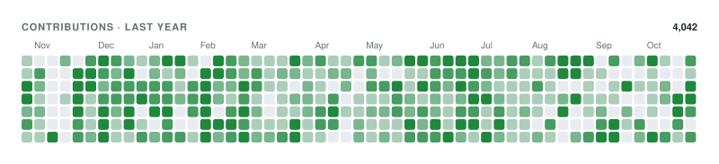
      </picture></td>
  </tr>
  <tr>
    <td colspan="2">
      <picture>
        <source media="(prefers-color-scheme: dark)" srcset="assets/charts/github-streak-dark.svg">
        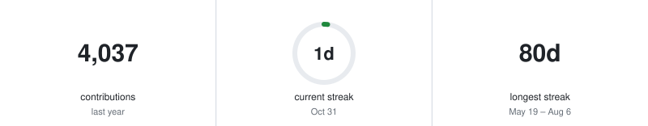
      </picture>
    </td>
  </tr>
  <tr>
    <td width="50%"><picture>
        <source media="(prefers-color-scheme: dark)" srcset="assets/charts/github-overview-dark.svg">
        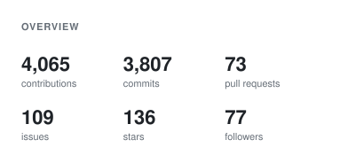
      </picture></td>
    <td width="50%"><picture>
        <source media="(prefers-color-scheme: dark)" srcset="assets/charts/github-activity-dark.svg">
        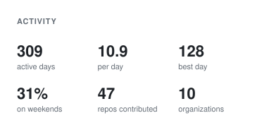
      </picture></td>
  </tr>
  <tr>
    <td width="50%"><picture>
        <source media="(prefers-color-scheme: dark)" srcset="assets/charts/github-languages-dark.svg">
        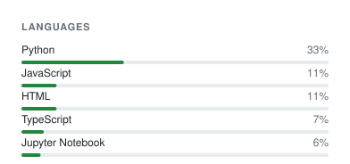
      </picture></td>
    <td width="50%"><picture>
        <source media="(prefers-color-scheme: dark)" srcset="assets/charts/github-weekdays-dark.svg">
        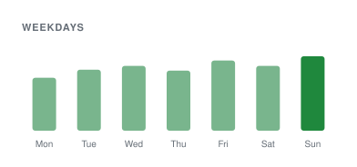
      </picture></td>
  </tr>
</table>

<table width="100%">
  <tr>
    <th>Code time</th>
  </tr>
  <tr>
    <td><picture>
        <source media="(prefers-color-scheme: dark)" srcset="assets/charts/code-time-dark.svg">
        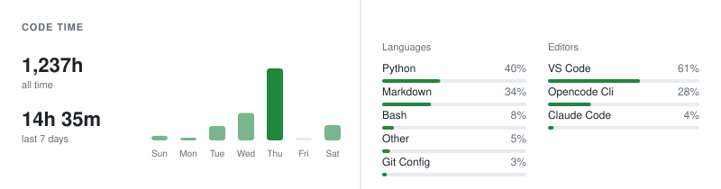
      </picture></td>
  </tr>
</table>

<table width="100%">
  <tr>
    <th colspan="2">Anime &amp; Manga</th>
  </tr>
  <tr>
    <td colspan="2"><a href="https://anilist.co/user/SpreadSheeets"><picture>
        <source media="(prefers-color-scheme: dark)" srcset="assets/charts/anilist-totals-dark.svg">
        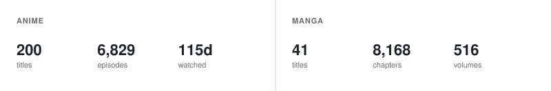
      </picture></a></td>
  </tr>
  <tr>
    <td width="50%"><picture>
        <source media="(prefers-color-scheme: dark)" srcset="assets/charts/anilist-anime-dark.svg">
        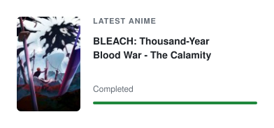
      </picture></td>
    <td width="50%"><picture>
        <source media="(prefers-color-scheme: dark)" srcset="assets/charts/anilist-manga-dark.svg">
        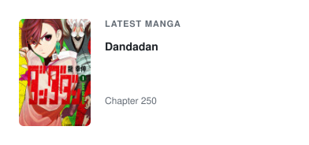
      </picture></td>
  </tr>
</table>

<table width="100%">
  <tr>
    <th colspan="2">Games</th>
  </tr>
  <tr>
    <td colspan="2"><a href="https://steamcommunity.com/id/SpreadSheeets/"><picture>
        <source media="(prefers-color-scheme: dark)" srcset="assets/charts/steam-totals-dark.svg">
        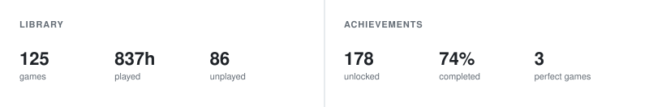
      </picture></a></td>
  </tr>
  <tr>
    <td width="50%"><picture>
        <source media="(prefers-color-scheme: dark)" srcset="assets/charts/steam-most-played-dark.svg">
        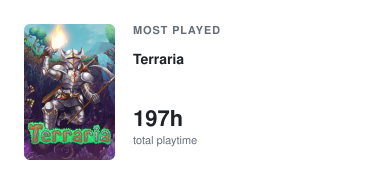
      </picture></td>
    <td width="50%"><picture>
        <source media="(prefers-color-scheme: dark)" srcset="assets/charts/steam-latest-dark.svg">
        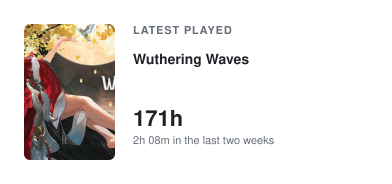
      </picture></td>
  </tr>
</table>

<table width="100%">
  <tr>
    <th>Status</th>
  </tr>
  <tr>
    <td><a href="https://discord.com/users/727012870683885578"><picture>
        <source media="(prefers-color-scheme: dark)" srcset="https://spreadsheets600-api-io.spreadsheets600.workers.dev/discord?theme=dark">
        
      </picture></a></td>
  </tr>
  <tr>
    <td><a href="https://open.spotify.com/user/x4o0yd3uqpjbzgo1atn61ik6l"><picture>
        <source media="(prefers-color-scheme: dark)" srcset="https://spreadsheets600-api-io.spreadsheets600.workers.dev/spotify?theme=dark">
        
      </picture></a></td>
  </tr>
</table>

<table width="100%">
  <tr>
    <th>Badges</th>
  </tr>
  <tr>
    <td align="center"></td>
  </tr>
</table>
